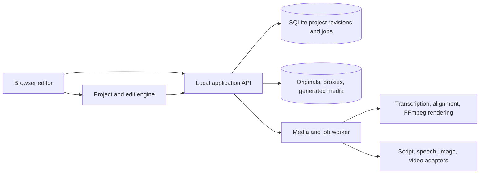

# Proposed design: AI video editing and generation with voice

Status: **proposed for review, not an approved specification or implementation plan**.

## Intent and assumptions

The user wants Descript-style capabilities, prioritizing AI video editing and video generation with voice. The complete ambition also includes image generation and AI voice. Success means making real, editable, exportable videos, with linked transcript and timeline changes.

Working assumption: start with one creator on this Mac, using a browser editor and a local media worker. This deployment assumption is open for correction; the user clarified the workflows but has not selected a commercial/multi-user deployment model.

Build original source and product assets. The [investigation](../research/2026-10-19-descript.md) supplies observed/documented workflow contracts, not Descript's internal architecture. Exact visual matching, all-feature parity, model quality parity, and production scale have not been established.

## Approach comparison

| Approach | Strength | Cost or limitation |
| --- | --- | --- |
| **Browser editor plus local media worker — recommended** | Fast iteration, local file processing, deterministic exports, separable provider integrations | Requires a local worker; desktop packaging comes later |
| Electron application from the start | Native file access and desktop experience | Adds packaging, updates, IPC, and platform work before the editing pipeline is proven |
| Interface over Descript's API | Potentially fast access to supported Descript operations | Dependent on vendor access/credits; does not deliver an independent clone or establish parity |

The recommended architecture keeps the project format and editing engine independent of the UI shell so desktop packaging remains possible.

## User experience

Home has three primary starting points: upload footage, describe a video, and paste a script. The editor combines a transcript/script pane, preview canvas, AI conversation, scene/asset controls, and timeline. Transport and selection stay synchronized across panes.

Use the same project after generation: the result opens as editable scenes and tracks. Generation is not a separate player containing a flattened, uneditable video.

### Edit existing video

1. Import video/audio and build a playable proxy and word-timed transcript.
2. Selecting text seeks/highlights linked source media; deleting text creates a non-destructive cut.
3. AI instructions such as removing filler words, shortening pauses, producing a rough cut, or adding B-roll produce explicit proposed edits.
4. Applying a proposal updates script, clips, scenes, captions, duration, and undo history together.
5. Adjust reframing, captions, levels, and scene visuals, then export the active composition.

Deleting transcript words and rewriting narration are separate intentions. Typing new words must never imply that the original recording now contains them. New spoken text enters a clearly selected synthesis/regeneration flow. Transcript-only correction, removal of linked media, and replacement with silence must also remain distinct operations.

### Generate a video with voice

1. Enter an idea or paste a script; choose language, output shape, narration voice, and visual style.
2. Create/edit the script and storyboard before committing generation work.
3. Synthesize narration first and obtain its actual duration and word alignment.
4. Allocate scene durations from that audio, then request generated visuals or use selected media.
5. Fit visuals to scene durations without changing spoken meaning; add captions and optionally mix music.
6. Open the resulting composition in the same editor; allow per-scene replacement and voice regeneration.
7. Export a real MP4 and an optional caption file.

For longer narration than one generated clip supports, compose several shots or explicitly extend a scene. Do not silently truncate narration or claim a provider can generate arbitrary durations. Generated clip audio must be deliberately retained, muted, or mixed to avoid competing narration.

### Generate individual assets

Provide image and video modes, independent prompt drafts/history, model selection, and controls driven by the selected model's supported inputs. Insert a selected result into a chosen scene as a versioned asset. Preserve prompt, model, settings, provider job ID, and result metadata.

### AI voice

Start with supported stock voices and script-to-speech. Regenerating a sentence creates a new audio asset and realigns the affected region. Store the selected voice/model and settings with the asset. Preview playback and exported audio must use the same rendered narration.

Custom voice cloning, translated dubbing, avatars, and lipsync remain in the full roadmap. Add each through an explicit provider contract and a verified workflow. The first release must not imply these work merely because a control exists.

## Proposed system boundaries

- **UI:** TypeScript/React; script editing, preview, timeline, AI proposals, job progress, and export controls.
- **Domain engine:** typed project data, timeline/source-time mapping, selection, edit validation, and undo/redo. No provider/network dependencies.
- **Application API:** project persistence, media admission, provider configuration, and revision-checked commands.
- **Media worker:** probe/normalize media, produce proxies/waveforms, transcribe/align, render captions/audio/video, and report job progress.
- **Provider adapters:** separate capabilities for language planning, transcription, speech, image, video, and later avatars/lipsync. A model name in Descript is not sufficient to implement any adapter.

SQLite and local media storage suit the initial single-creator assumption. A shared service/object store/authentication layer can replace those boundaries if a multi-user product is selected. Do not build collaboration/billing before that requirement is confirmed.

## Project model and invariants

| Entity | Required information |
| --- | --- |
| Project revision | Schema version, immutable revision ID, parent revision, title, output settings |
| Source/generated asset | ID, checksum, storage key, streams, duration, provenance, readiness |
| Transcript token | Stable ID, source asset, text, speaker, start/end time, confidence/alignment state |
| Clip | Asset, source in/out, timeline start, track, speed, gain, transform |
| Scene | Ordered identity, duration, visual/audio layers, captions/layout |
| Edit proposal | Base revision, typed operations, preconditions, rationale, validation result |
| Generation job | Provider/model, capability snapshot, idempotency key, external job ID, status, attempts, artifacts |

Use one canonical integer timeline unit and explicit conversions to media sample/frame coordinates. Display time formatting must not become the stored timing representation. Validate monotonic token times, legal source ranges, positive clip durations, and linked selection mappings.

Keep originals immutable. An edit produces a new project revision with an undoable change set. A stale AI proposal must be revalidated against the current revision. Export uses a frozen project revision so editing during export cannot change its contents.

## AI editing contract

An AI planner receives the relevant transcript, selected scene metadata, and available operations. It returns structured proposals such as `RemoveTokenRange`, `TrimClip`, `SplitScene`, `SetCaptionStyle`, `InsertAsset`, or `RegenerateNarration`.

The engine validates operations before application. Cross-scene cuts, reordered speech, ambiguous transcript alignment, missing assets, and stale revisions must be handled explicitly. The planner does not produce arbitrary shell commands or mutate project files directly.

Preview edits before applying them. After application, text, media, caption timing, and undo must describe the same revision. Voice regeneration and expensive media generation are visible operations with job progress.

## Job execution and provider selection

Persist `queued`, `running`, `waiting_provider`, `succeeded`, `failed`, and `cancelled` states. Save external job IDs as soon as received. After a timeout or restart, reconcile existing jobs before submitting another potentially billable request.

Declare each adapter's supported language, duration, aspect ratio, resolution, reference inputs, native audio behavior, cancellation, and polling/webhook contract. Validate settings before submission. Separate failure from an empty result; never display a placeholder as generated media.

Provider/model selection remains open until current access, supported API contracts, quality samples, and acceptable spending are established. No credentials have been inspected and no billable provider request is authorized by this design document. This is a real integration dependency, not a reason to substitute synthetic success claims.

## Delivery slices and acceptance

These slices sequence the full requested product; they do not redefine the final goal as a mockup.

| Slice | Deliverable | Required evidence |
| --- | --- | --- |
| 1. Editing foundation | Import, proxy playback, timed transcript, linked selections, word/range cuts, undo, persistence, captions, export | A controlled clip is cut through its transcript; saved/reopened preview and MP4 contain the expected media; timing checked against known markers |
| 2. AI editing | Structured cleanup/rough-cut/B-roll proposals with validation | A real selected-region instruction produces correct operations; invalid/stale operations fail safely; undo restores prior media |
| 3. Voice generation | Script narration, voice selection, alignment, sentence regeneration | Real audio is generated, played, aligned, inserted, and exported; provider failure/retry behavior recorded |
| 4. Video generation with voice | Prompt/script to storyboard, narrated scenes, generated video assets, editable composition | A short real video with intelligible narration, correct scene durations, captions, persistent assets, and a playable export |
| 5. Image generation and visual parity | Generated images, per-scene asset iterations, capability-driven controls, refined interaction/layout matching | Actual outputs inserted into scenes; unsupported options rejected; observed reference flows compared with implementation |
| 6. Extended parity | Custom voices, avatars/lipsync, dubbing, advanced cleanup, desktop packaging, and optionally teams | Separate real-provider and product acceptance for each feature |

Slice 1 is the first proposed implementation scope. Local editing proves the media model before generation dependencies are added. Slice 4 is the first acceptance point covering the user's complete priority workflow of AI editing plus generated video with voice.

## Verification strategy

- Use a short controlled source with known spoken words, filler words, pauses, and audio/visual timing markers.
- Verify transcript cuts, moving ranges, undo/redo, revision conflicts, persistence, and source/composition-time mapping.
- Exercise the browser workflow and inspect the exported file's streams, duration, visible frames, audible words, and caption synchronization.
- Exercise long-job failure, timeout, restart, duplicate submission, missing result, and cancellation where the chosen provider supports it.
- Separate domain/unit checks, synthetic provider tests, real-provider evidence, and user-visible output quality. None substitutes for the others.

No acceptance above has run yet. Only the REA installation, static artifact analysis, limited live UI observation, and documentation research described in the investigation have been performed.

## Review decision

Review the recommended browser/local-worker approach, the transcript-first editing model, and the narrated-generation pipeline. Confirm the single-creator-on-this-Mac assumption or replace it. After the design is agreed, turn Slice 1 into an approved specification and implementation plan; retain the remaining slices as the full-product roadmap.
